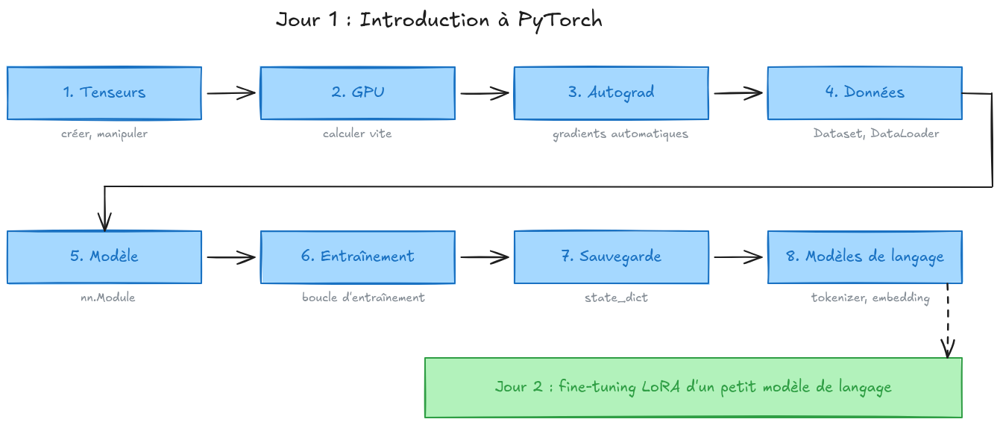

# Atelier PyTorch · Deep Learning IndabaX RDC 2026

**Intelligence artificielle et langues congolaises : construire des ressources numériques ouvertes**
Université Nouveaux Horizons (UNH), Lubumbashi · 26 au 28 novembre 2026

Ce dépôt contient le matériel de l'atelier PyTorch de l'IndabaX RDC 2026.
Les notebooks suivent les tutoriels officiels de PyTorch. Ils sont en français, avec des schémas et des exercices.
Tout fonctionne dans **Google Colab**, avec le GPU gratuit (NVIDIA T4). Vous n'avez rien à installer.

*English: PyTorch workshop material for Deep Learning IndabaX DRC 2026 (Lubumbashi). The notebooks are in French and follow the official PyTorch "Learn the Basics" tutorials. They run on free Google Colab.*

## Les notebooks

| Jour | Notebook | Contenu | Ouvrir |
|---|---|---|---|
| Jour 1 (26 nov.) | [`Jour1_Introduction_PyTorch.ipynb`](notebooks/Jour1_Introduction_PyTorch.ipynb) | Tenseurs, GPU, autograd, données, modèle, boucle d'entraînement, sauvegarde, pont vers les modèles de langage | [](https://colab.research.google.com/github/ganji759/IndabaX-DRC-2026-PyTorch-Workshop/blob/main/notebooks/Jour1_Introduction_PyTorch.ipynb) |
| Jour 2 (27 nov.) | à venir | Fine-tuning LoRA d'un petit modèle de langage en swahili, inférence, déploiement avec ExecuTorch | - |

## Jour 1 : Introduction à PyTorch



| Partie | Sujet | Durée indicative | Tutoriel officiel |
|---|---|---|---|
| 0 | Mise en place de Colab | 5 min | - |
| 1 | Les tenseurs | 15 min | [Tensors](https://docs.pytorch.org/tutorials/beginner/basics/tensorqs_tutorial.html) |
| 2 | Le GPU | 5 min | [Tensors](https://docs.pytorch.org/tutorials/beginner/basics/tensorqs_tutorial.html) |
| 3 | Autograd et descente de gradient | 15 min | [Autograd](https://docs.pytorch.org/tutorials/beginner/basics/autogradqs_tutorial.html) |
| 4 | Les données (FashionMNIST) | 10 min | [Datasets & DataLoaders](https://docs.pytorch.org/tutorials/beginner/basics/data_tutorial.html) |
| 5 | Construire le modèle | 10 min | [Build Model](https://docs.pytorch.org/tutorials/beginner/basics/buildmodel_tutorial.html) |
| 6 | La boucle d'entraînement | 15 min | [Optimization](https://docs.pytorch.org/tutorials/beginner/basics/optimization_tutorial.html) |
| 7 | Sauvegarder et charger | 5 min | [Save & Load](https://docs.pytorch.org/tutorials/beginner/basics/saveloadrun_tutorial.html) |
| 8 | Pont vers le Jour 2 : tokenizer, `nn.Embedding`, mini modèle de langage en swahili | 10 min | - |

Le notebook contient 3 exercices avec leurs solutions (cliquez sur « Voir la solution ») et 4 exercices bonus.

## Comment commencer

1. Cliquez sur le badge **Open in Colab** ci-dessus.
2. Connectez-vous avec votre compte Google.
3. Menu **Exécution → Modifier le type d'exécution** → **GPU T4** → **Enregistrer**.
4. Exécutez les cellules dans l'ordre avec **Maj + Entrée**.

**Prérequis :** des bases de Python. Un compte Google. Aucun compte Hugging Face n'est nécessaire.

**Travail en équipe :** le GPU gratuit de Colab n'est pas garanti. Travaillez par équipes de 2 ou 3. Un GPU par équipe suffit. Sans GPU, le notebook fonctionne aussi sur CPU, plus lentement.

## Contenu du dépôt

```
notebooks/            les notebooks de l'atelier
images/               les schémas (PNG) utilisés dans les notebooks
images/excalidraw/    les sources des schémas (.excalidraw)
```

Pour modifier un schéma : ouvrez [excalidraw.com](https://excalidraw.com), puis **Ouvrir** le fichier `.excalidraw`.

## Ressources officielles

- [PyTorch : Learn the Basics](https://docs.pytorch.org/tutorials/beginner/basics/intro.html)
- [Deep Learning with PyTorch: A 60 Minute Blitz](https://docs.pytorch.org/tutorials/beginner/deep_learning_60min_blitz.html)
- [Documentation de PyTorch](https://docs.pytorch.org/docs/stable/index.html)
- [Forum PyTorch](https://discuss.pytorch.org/)

## Crédits et licence

- Les notebooks adaptent les tutoriels [PyTorch Learn the Basics](https://github.com/pytorch/tutorials/tree/main/beginner_source/basics) (licence BSD-3-Clause, © Pytorch contributors).
- Données : [FashionMNIST](https://github.com/zalandoresearch/fashion-mnist) (Zalando Research, licence MIT).
- Tokenizer de démonstration : [`HuggingFaceTB/SmolLM2-135M-Instruct`](https://huggingface.co/HuggingFaceTB/SmolLM2-135M-Instruct) (licence Apache-2.0).
- Schémas faits avec [Excalidraw](https://excalidraw.com).

Ce dépôt est sous licence [BSD-3-Clause](LICENSE).
